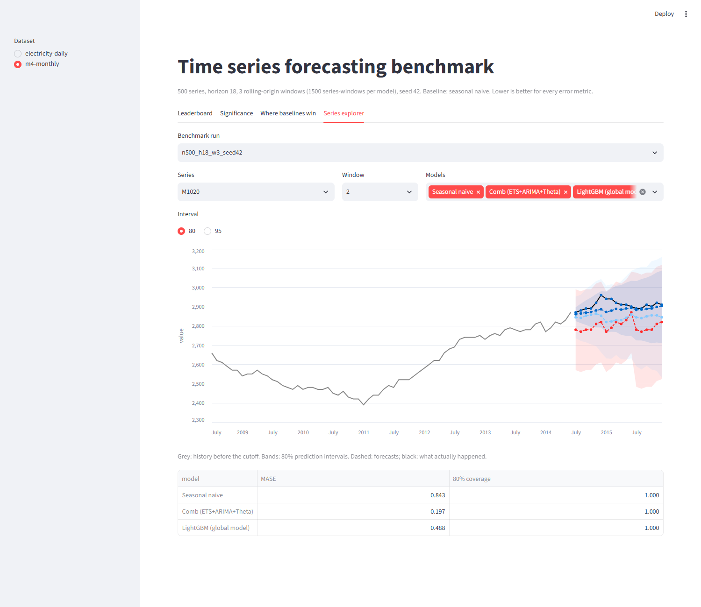

# Time Series Forecasting Benchmark

A reproducible comparison of 10 forecasting methods (naive baselines, statistical models,
Prophet and a global LightGBM) on two public datasets, with rolling-origin evaluation,
interval scoring, runtime cost and significance tests.

> Part of the Live Projects portfolio. See [SHARED_STANDARDS.md](../SHARED_STANDARDS.md) for conventions and the milestone definition of done.

**Results at a glance (M4-Monthly, 500 series × 3 rolling windows, h = 18)**

* **An equal-weight combination of ETS, ARIMA and Theta improved MASE by 28.0% against
  seasonal naive** (0.955 vs 1.326) across 1,500 series-windows. It beat seasonal naive on 81%
  of series (Wilcoxon, Holm-corrected p = 3e-51), with well-calibrated 80% intervals (79.7%
  coverage).
* **The cheap model is nearly as good, but not equal.** AutoETS alone improved MASE by
  25.4% at 5% of the combination's compute (150 ms vs 2.9 s per series on one core). The
  Nemenyi test could not separate the two on this sample, but on a second, independent
  500-series sample it could (mean-rank gap 0.73 > 0.61), so "statistically tied" did not
  replicate.
* **The main conclusions replicate on a second sample** of 500 different series (seed 7, 10
  shared): Comb is best again (−25.7% MASE vs seasonal naive), Prophet is last again with
  61% coverage at 95%, and the 10-method ranking correlates at Spearman 0.92.
* **Prophet was the worst method,** 9.7% *worse* than seasonal naive, and its nominal 95%
  intervals covered only 61% of outcomes.
* **Optimization:** making LightGBM's conformal intervals scale with each series' volatility
  cut its interval score (MSIS) by 51% (22.4 → 11.0) at the same 95% coverage (94.7% vs 94.9%).
* **Where simple baselines win:** the official M4 benchmark Naive2 beats the combination on
  47% of series with no seasonality, but on only 23% of strongly seasonal series and 22% of
  strongly trending ones.

**Second dataset (UCI electricity, 342 clients × 3 windows, daily, h = 14)**

* **The ranking flips on long, homogeneous series.** The global LightGBM is the most accurate
  method. It improved MASE by 3.0% against seasonal naive (0.980 vs 1.010) and was the only
  model besides Comb to beat it significantly (Holm p = 1e-6).
* **Optimization 2:** calibrating LightGBM's intervals over a year of forecast origins
  instead of the last 14 days fixed their under-coverage (95% intervals: 90.0% → 94.0%;
  80%: 76.0% → 80.5%). It also cut MSIS by 6.6% (11.64 → 10.87), the best interval score of
  any method on this dataset.
* **Seasonal naive is hard to beat here.** AutoARIMA, AutoTheta and Naive2 are no better, or
  worse. The lesson from M4 that statistical models clearly win does not transfer to a
  daily load series with a strong weekly cycle.

## Overview

Forecasting papers and blog posts often skip strong simple baselines, report one error
metric on one split, and never ask whether the differences are real. This benchmark runs
every method through the **same rolling-origin cross-validation** and scores it on:

* point accuracy: MASE, sMAPE and RMSE;
* uncertainty: 80% and 95% interval coverage and the M4 **MSIS** interval score;
* cost: fit-and-predict time per series, both parallel and on a single core;
* significance: per-series **Diebold-Mariano** tests, **Wilcoxon** signed-rank tests with
  Holm correction, and a **Friedman + Nemenyi** rank test across all models.

It then looks at *which* series the simple methods win on, using STL trend and seasonal
strength, history length and volatility.

| Method | What it is | Library |
|---|---|---|
| `snaive` | Seasonal naive: repeat the last season (**the named baseline**) | numpy |
| `naive` | Repeat the last value | numpy |
| `naive2` | Naive on seasonally adjusted data, the official M4 benchmark | numpy |
| `ets` | AutoETS (error/trend/season selected by AICc) | statsforecast |
| `arima` | AutoARIMA (Hyndman-Khandakar stepwise search) | statsforecast |
| `theta` | AutoTheta (best of standard, optimised and dynamic Theta) | statsforecast |
| `comb` | Equal-weight mean of ETS, ARIMA and Theta (the M4 "Comb" idea) | - |
| `sarima` | Fixed SARIMA(0,1,1)(0,1,1)m, the "airline" model | statsmodels |
| `prophet` | Additive trend + seasonality | prophet |
| `lgbm` | One global LightGBM across all series: lags, rolling means, calendar position; recursive; split-conformal intervals calibrated over about one year of origins | lightgbm |

## Tech Stack

| Layer | Tools |
|---|---|
| Classical / statistical | statsforecast (AutoETS, AutoARIMA, AutoTheta), statsmodels (SARIMA, STL) |
| Additive models | Prophet |
| ML | LightGBM, global model with conformal prediction intervals |
| Evaluation | custom MASE / sMAPE / MSIS / coverage; SciPy (Wilcoxon, Friedman, studentized range); Diebold-Mariano with HAC variance |
| Data | pandas, pyarrow (parquet cache) |
| Reporting | matplotlib, Markdown reports, Streamlit dashboard, optional MLflow logging |
| Delivery | Docker, docker compose, GitHub Actions |

## Architecture

```
 M4-Monthly (GitHub)  ┐                      ┌─► parquet cache (long format: unique_id, ds, y)
 UCI electricity      ┴─► loaders + sampling ┘
                                   │
                                   ▼
            rolling-origin backtester: same cutoffs for every model,
            last window = official M4 test period
     ┌──────────┬───────────┬──────────┼──────────┬───────────┬──────────┐
     ▼          ▼           ▼          ▼          ▼           ▼          ▼
  naive /    AutoETS    AutoARIMA   AutoTheta   SARIMA     Prophet   LightGBM
  snaive /                                     airline               (global,
  naive2       └──── comb (mean) ────┘                               conformal)
                                   │  per-model scores + forecasts saved (resumable)
                                   ▼
        metrics: MASE, sMAPE, RMSE, coverage, MSIS, OWA, ms/series
                                   ▼
        significance: Diebold-Mariano (per series), Wilcoxon + Holm, Friedman + Nemenyi
                                   ▼
        report.md + plots ─► docs/results/<dataset>/ ─► Streamlit dashboard
```

| Component | Responsibility |
|---|---|
| `data.py` | Download, sample and cache each dataset in long format; dataset specs (frequency, season, horizon) |
| `models.py` | 10 forecasters behind one `forecast(train, h, season, levels)` interface |
| `backtest.py` | Rolling-origin splits, per-series scoring, leaderboard, combination cost attribution |
| `metrics.py` | MASE, sMAPE, RMSE, coverage, MSIS |
| `stats.py` | Diebold-Mariano (HAC + HLN correction), Wilcoxon + Holm, Friedman + Nemenyi |
| `benchmark.py` | CLI: runs models, saves per-model scores and forecasts, reuses them on re-runs, optional MLflow logging |
| `report.py`, `analysis.py` | Significance tables, plots, the "where baselines win" analysis |
| `dashboard.py` | Streamlit app over the published results, plus a per-series forecast explorer |

## Setup

### Prerequisites
- Python 3.11
- About 1.5 GB of free disk space (raw M4-Monthly and the UCI electricity file)
- Optional: Docker Desktop, GNU Make (see the Windows note below)

### Install
```bash
git clone https://github.com/GunjanPR/04-time-series-forecasting.git && cd 04-time-series-forecasting
py -3.11 -m venv .venv            # Windows; on macOS/Linux use: python3.11 -m venv .venv
source .venv/Scripts/activate     # Git Bash; PowerShell: .venv\Scripts\Activate.ps1; macOS/Linux: source .venv/bin/activate
make install                      # = pip install -e ".[dev,tracking,dashboard]"
```

### Environment config
```bash
cp .env.example .env              # optional; every setting has a default
```
The settings are the dataset, horizon and windows (blank means the dataset's default),
the series sample size, the seed and parallelism. No secrets are needed.
`MLFLOW_TRACKING_URI` turns on experiment logging.

On Windows, Prophet's Stan binary can pick up an unrelated `tbb.dll` from System32 and
crash with error 0xC0000139. `ensure_prophet_tbb()` copies the right DLL next to the
binary automatically.

## How to Run

> **Windows note:** `make` isn't installed on Windows by default. Install it with `choco install make`, or run the
> targets from **Git Bash**. You can also run the commands in the `Makefile` yourself
> (for example, `python -m pytest` instead of `make test`).

### Run the benchmark
```bash
make run                          # M4-Monthly, all 10 models (downloads data on first run)
make run-electricity              # UCI electricity, daily
make report                       # significance tables + plots -> docs/results/<dataset>/
make dashboard                    # Streamlit app on http://localhost:8501
python -m ts_forecasting.benchmark --models snaive,ets,theta --max-series 100 --windows 2
```
Per-model scores are saved under `results/<dataset>/<config>/`, and a re-run reuses every
model that already finished (`--force` recomputes). An interrupted run therefore resumes.



*Series explorer: history before the cutoff (grey), the actuals (black), and each model's
forecast with its prediction interval. The Leaderboard, Significance and Where-baselines-win
tabs show the published results for either dataset
([screenshot](docs/dashboard-leaderboard.png)).*

### Docker
```bash
docker compose up --build         # runs the M4 benchmark, then serves the dashboard on :8501
```

### Lint and test
```bash
make lint     # ruff check + ruff format --check
make test     # pytest: 65 tests (no network; one dashboard test needs streamlit)
make coverage # the same with line coverage (fails below 70%)
make format   # auto-fix lint and formatting
```

## Evaluation & Results

**Method.** Each series is cut at `n_windows` origins, each `h` steps apart. Every model
is fitted on the history before the cutoff and forecasts the next `h` points. The same
cutoffs are used for every model, and the last window is the final `h` points of each
series. MASE is scaled by the in-sample seasonal-naive MAE of the training part of that
window. Errors are averaged over series-windows. Hardware: Intel Core i5-13420H (8 cores /
12 threads), 16 GB RAM, Windows 11, on AC power.

### M4-Monthly: 500 series, h = 18, 3 windows (1,500 series-windows per model)

The 500 series are sampled with seed 42 from those with at least 90 observations. The
official train and test files are joined, so window 3 is exactly the M4 test period.
Named baseline: **seasonal naive**. Lower is better everywhere.

| Model | MASE | vs baseline | OWA | sMAPE | 80% cov. | 95% cov. | MSIS (95%) | ms / series, 12 workers | ms / series, 1 core |
|---|---|---|---|---|---|---|---|---|---|
| **Comb (ETS+ARIMA+Theta)** | **0.955** | **−28.0%** | **0.915** | **9.49** | 79.7% | 91.6% | **9.09** | 683 | 2,933 |
| AutoETS | 0.990 | −25.4% | 0.942 | 9.70 | 78.6% | 90.9% | 9.36 | 48 | 150 |
| SARIMA airline | 0.990 | −25.3% | 0.972 | 10.31 | 79.6% | 91.3% | 10.13 | 56 | 250 |
| AutoTheta | 0.992 | −25.2% | 0.953 | 9.89 | 75.0% | 87.2% | 10.87 | 26 | 29 |
| AutoARIMA | 0.998 | −24.7% | 0.961 | 10.01 | 77.4% | 89.6% | 10.81 | 608 | 2,754 |
| Naive2 (M4 benchmark) | 1.063 | −19.9% | 1.000 | 10.18 | 81.3% | 91.4% | 11.67 | 1.5 | 1.7 |
| LightGBM (global model) | 1.107 | −16.5% | 1.018 | 10.13 | 80.4% | 94.7% | 10.97 | 25 | 39 |
| Naive | 1.235 | −6.9% | 1.139 | 11.36 | 84.7% | 93.2% | 13.32 | 0.5 | 0.7 |
| **Seasonal naive (baseline)** | 1.326 | - | 1.220 | 12.14 | 78.2% | 91.5% | 12.44 | 0.4 | 0.5 |
| Prophet | 1.454 | +9.7% | 1.457 | 15.74 | 45.0% | 61.4% | 23.18 | 62 | 282 |

*OWA = M4 Overall Weighted Average relative to Naive2. The single-core column comes from a
separate 100-series, 1-window run with `--n-jobs 1`. The combination is charged the summed
runtime of its three members.*

**Is it significant?** ([full table](docs/results/m4-monthly/report.md))

| Model vs seasonal naive | Mean MASE diff (95% CI) | Series won | Wilcoxon p (Holm) | DM: better / worse | Mean rank |
|---|---|---|---|---|---|
| Comb | −0.371 (−0.418, −0.324) | 81.0% | 3e-51 | 48.8% / 3.4% | **3.99** |
| AutoETS | −0.336 (−0.385, −0.288) | 81.0% | 7e-47 | 48.8% / 3.0% | 4.46 |
| AutoARIMA | −0.328 (−0.377, −0.279) | 79.0% | 7e-40 | 43.0% / 4.6% | 4.64 |
| AutoTheta | −0.334 (−0.389, −0.281) | 76.4% | 8e-39 | 45.2% / 7.2% | 4.75 |
| SARIMA airline | −0.336 (−0.390, −0.284) | 75.0% | 8e-39 | 43.0% / 5.6% | 4.76 |
| Naive2 | −0.264 (−0.312, −0.218) | 74.2% | 6e-33 | 47.2% / 6.4% | 5.38 |
| LightGBM | −0.219 (−0.249, −0.189) | 81.6% | 2e-46 | 46.0% / 3.6% | 5.66 |
| Naive | −0.091 (−0.158, −0.020) | 64.8% | 7e-09 | 40.0% / 16.8% | 6.23 |
| Prophet | +0.128 (+0.065, +0.189) | 46.0% | 2e-04 | 17.0% / 31.0% | 7.54 |

The Friedman test rejects equal performance across the 10 models (p = 1e-162). The Nemenyi
critical difference is 0.61 mean ranks, so:

* Comb is significantly better than every model except AutoETS (4.46).
* The four single statistical models (ETS, ARIMA, Theta, SARIMA) are within 0.30 ranks of
  each other, so they are not distinguishable.
* All of them, and Comb, rank significantly above Naive2, LightGBM and Prophet.


**What the numbers say**

* **Model choice is a cost decision.** AutoETS is within 3.7% of the best MASE at 5% of its
  compute (statistically tied on this sample, but not on the second one below). AutoTheta is within 4% of the best MASE at 1% of the compute, though
  its intervals are too narrow (87% coverage at 95%).
* **LightGBM wins often but loses big.** It beats seasonal naive on 81.6% of series, more
  than any other model, but a heavy tail of bad recursive forecasts leaves its mean MASE
  behind Naive2. A global model trained on 500 short monthly series is a weak setting for
  gradient boosting, and the median tells a different story from the mean.
* **Prophet is miscalibrated.** It is the only method worse than seasonal naive, and its
  intervals cover far less than they claim.
* **Error grows with the horizon for every model,** with a visible step after one full
  season, at month 13 ([plot](docs/results/m4-monthly/mase_by_step.png)).

### Robustness: a second, independent sample of 500 series

Every number above comes from one random sample (seed 42) of the M4 monthly series with at
least 90 observations. To check that the conclusions are not an accident of that draw, the
whole benchmark was re-run on a second sample (seed 7; only 10 of its 500 series are in the
first). Same 10 methods, horizon, windows and code; run on the laptop on 2026-10-19
([report](docs/results/m4-monthly-seed7/report.md), reproduce with the commands in
[scripts/compare_samples.py](scripts/compare_samples.py),
[side by side](docs/results/m4-monthly-seed7/sample_comparison.csv)).

| Model | MASE, seed 42 | MASE, seed 7 | vs seasonal naive, 42 / 7 | 95% coverage, 42 / 7 | Rank, 42 / 7 |
|---|---|---|---|---|---|
| Comb (ETS+ARIMA+Theta) | 0.955 | 0.959 | −28.0% / −25.7% | 91.6% / 92.0% | 1 / 1 |
| AutoETS | 0.990 | 1.006 | −25.4% / −22.1% | 90.9% / 90.8% | 2 / 4 |
| SARIMA airline | 0.990 | 0.991 | −25.3% / −23.2% | 91.3% / 91.2% | 3 / 3 |
| AutoTheta | 0.992 | 1.019 | −25.2% / −21.0% | 87.2% / 86.6% | 4 / 5 |
| AutoARIMA | 0.998 | 0.987 | −24.7% / −23.5% | 89.6% / 90.6% | 5 / 2 |
| Naive2 | 1.063 | 1.091 | −19.9% / −15.4% | 91.4% / 91.5% | 6 / 6 |
| LightGBM (global) | 1.107 | 1.107 | −16.5% / −14.2% | 94.7% / 95.2% | 7 / 7 |
| Naive | 1.235 | 1.280 | −6.9% / −0.8% | 93.2% / 93.3% | 8 / 8 |
| Seasonal naive | 1.326 | 1.290 | - | 91.5% / 92.2% | 9 / 9 |
| Prophet | 1.454 | 1.454 | +9.7% / +12.6% | 61.4% / 61.2% | 10 / 10 |

* **What holds:** Comb is the most accurate method on both samples, and Prophet the least,
  with the same badly under-covering intervals. The top five are all statistical models,
  LightGBM and the naive methods keep their places, and the MASE ranking of the 10 methods
  correlates at Spearman 0.92 (p = 2e-4). The four single statistical models are again
  within 0.3 mean ranks of each other.
* **What does not:** the order inside the top five moves (AutoARIMA 5th → 2nd, AutoETS 2nd →
  4th), and on the second sample Comb is significantly better than every other method,
  AutoETS included (mean ranks 3.83 vs 4.57, Nemenyi CD 0.61). The single-sample claim that
  AutoETS is statistically tied with the best method is therefore not robust; "within 4-5%
  of the best at 5% of the compute" is.
* The size of Comb's lead over seasonal naive depends on the draw (−28.0% vs −25.7%), so the
  headline is better quoted as "about 26-28%".

### Optimization: LightGBM prediction intervals

The first version of the LightGBM intervals used split-conformal calibration with one error
distribution pooled across all series. It hit the coverage target, but the intervals were
far too wide for calm series. The fix divides each calibration error by the series' own
in-sample seasonal-naive MAE, so the interval width follows each series' volatility. The
point forecasts are unchanged.

| LightGBM intervals | 80% coverage | 95% coverage | MSIS (80%) | MSIS (95%) |
|---|---|---|---|---|
| Pooled (before; kept as `lgbm_global`) | 80.8% | 94.9% | 9.51 | 22.40 |
| **Volatility-adaptive (now)** | 80.4% | 94.7% | **5.95** | **10.97** (−51%) |

### Where simple baselines win (`analysis.py`)

Series are split into quintiles of features computed on the history before the first
backtest window, so no test data is used. The table shows how often **Naive2 beats the
combination**:

| Feature (quintile 1 → 5) | Naive2 win rate |
|---|---|
| Seasonal strength (none → strong) | 47% → 37% → 35% → 36% → 23% |
| Trend strength (weak → strong) | 36% → 41% → 40% → 39% → 22% |
| History length (short → long) | 38% → 38% → 44% → 27% → 31% |
| Volatility (calm → volatile) | 32% → 34% → 43% → 37% → 32% |

The simple benchmark is roughly a coin flip on series with no detectable seasonality. The
statistical models earn their keep on strongly seasonal and strongly trending series,
where Naive2 wins only about 1 in 4.
([plot](docs/results/m4-monthly/baseline_wins_naive2_vs_comb.png))

### UCI electricity: 342 clients, daily, h = 14, 3 windows (1,026 series-windows per model)

Data: [ElectricityLoadDiagrams20112014](https://archive.ics.uci.edu/dataset/321) (CC BY 4.0),
15-minute kW readings for 370 Portuguese clients, summed to daily kWh. Leading zeros
(clients that joined late) are trimmed. 28 clients are dropped because they have metering
gaps (more than 1% zero days) or less than 407 days of history, leaving 342 series of
455-1,461 days. The season is 7 (weekly);
Prophet also gets yearly seasonality.

| Model | MASE | vs seasonal naive | Median MASE | 80% cov. | 95% cov. | MSIS (95%) | ms / series, 12 workers |
|---|---|---|---|---|---|---|---|
| **LightGBM (global model)** | **0.980** | **−3.0%** | **0.810** | 80.5% | 94.0% | **10.87** | 74 |
| Comb (ETS+ARIMA+Theta) | 0.990 | −2.0% | 0.814 | 88.5% | 94.9% | 10.93 | 2,267 |
| AutoETS | 1.000 | −1.1% | 0.820 | 89.2% | 95.5% | 10.99 | 163 |
| SARIMA airline | 1.010 | 0.0% | 0.841 | 90.0% | 95.8% | 11.26 | 96 |
| **Seasonal naive (baseline)** | 1.010 | - | 0.859 | 89.5% | 95.6% | 11.15 | 0.6 |
| AutoARIMA | 1.016 | +0.5% | 0.839 | 85.2% | 93.4% | 11.15 | 1,912 |
| AutoTheta | 1.024 | +1.3% | 0.829 | 87.7% | 94.4% | 11.46 | 192 |
| Naive2 | 1.055 | +4.5% | 0.870 | 94.7% | 97.9% | 13.12 | 1.2 |
| Naive | 1.260 | +24.7% | 1.013 | 95.5% | 98.3% | 15.34 | 0.5 |
| Prophet | 1.282 | +26.9% | 1.095 | 70.7% | 86.5% | 12.25 | 80 |

Against seasonal naive ([full report](docs/results/electricity-daily/report.md)):

* LightGBM: −0.031 MASE (CI −0.048 to −0.013), wins on 64% of clients, Holm p = 1e-6.
* Comb: −0.021 (CI −0.037 to −0.003), wins on 62%, Holm p = 5e-4.
* AutoETS (Holm p = 0.05), SARIMA, AutoARIMA and AutoTheta are not significantly different
  from the baseline.
* Friedman p = 4e-80. With a Nemenyi CD of 0.73, Comb (mean rank 4.21) and LightGBM (4.51)
  are tied at the top.

**Reading the two datasets together**

| | M4-Monthly | Electricity (daily) |
|---|---|---|
| Series | 500 heterogeneous series of 91-936 months (median 275) | 342 related load profiles of 455-1,461 days (median 1,096) |
| Best method | Comb (−28.0% vs seasonal naive) | LightGBM (−3.0%) |
| LightGBM rank | 7th of 10, heavy-tailed errors | 1st |
| Seasonal naive | 9th of 10 | Middle of the pack, tied with SARIMA |
| Prophet | Last | Last |

A global gradient-boosted model needs many long, related series to learn from; with them it
wins, and without them the classical per-series models win. The only constants are that a
combination of statistical models is always near the top, and Prophet is always last.

### Optimization 2: calibrating LightGBM intervals over a year

The conformal intervals were first calibrated on one forecast origin: the last h points of
every history. On daily electricity that is the last 14 days. That window misses the
yearly cycle, so the intervals were too narrow, covering 90.0% at a nominal 95%. With
`calibration_origins = K`, one model fitted with the last K·h points held out forecasts from
K origins, and all their errors feed the conformal quantiles. The benchmark sets K to the
number of horizons in one year (`periods_per_year // h`). That is 26 for daily electricity
(h = 14) and 1 for M4 monthly (h = 18), where a single 18-month window already spans a
year. Point forecasts do not change.

Sweep on the laptop (i5-13420H, AC power; 342 series × 3 windows for electricity, 500 × 3
for M4):

| Electricity: origins K | 80% coverage | 95% coverage | MSIS (95%) |
|---|---|---|---|
| 1 (before) | 76.0% | 90.0% | 11.64 |
| 2 | 76.4% | 91.0% | 11.44 |
| 4 | 79.0% | 92.1% | 11.37 |
| 8 | 78.6% | 92.2% | 11.25 |
| 13 | 81.8% | 93.9% | 11.13 |
| **26 (now: one year)** | **80.5%** | **94.0%** | **10.87** |

| M4 monthly: origins K | 80% coverage | 95% coverage | MSIS (95%) |
|---|---|---|---|
| **1 (now: 18 months ≥ one year)** | **80.4%** | **94.7%** | **10.97** |
| 2 | 81.3% | 95.3% | 10.94 |
| 3 | 83.0% | 95.9% | 11.02 |
| 6 | 84.7% | 96.5% | 11.03 |

On M4 more origins over-cover, which is why the rule gives K = 1 there. On electricity,
LightGBM now has the best interval score of any method (10.87 vs 10.93 for Comb). Its 95%
coverage is still 1 point under nominal. Runtime is unchanged (74 ms per series).

## Milestones

Milestones follow [SHARED_STANDARDS.md](../SHARED_STANDARDS.md). Each one has a definition of done there.

### M1: Scaffold & baseline
- [x] Repo scaffold: `pyproject.toml`, Makefile, `.gitignore`, `.env.example`
- [x] Smoke test passes (`make test`)
- [x] Baseline: seasonal naive forecast + MASE on one dataset

### M2: Core functionality
- [x] Common model interface; ETS, ARIMA/SARIMA, statsforecast Auto*, Prophet, LightGBM wrappers
- [x] Rolling-origin backtester
- [x] `python -m ts_forecasting.benchmark` CLI

### M3: Data / storage layer
- [x] Data loaders for an M4 subset (Monthly) and an energy series (UCI electricity); M5 is not included (it needs Kaggle credentials)
- [x] Parquet cache in long format; dataset versions documented

### M4: Evaluation & testing
- [x] Metrics: MASE, sMAPE, RMSE, interval coverage, MSIS, runtime
- [x] Diebold-Mariano significance tests vs seasonal naive (plus Wilcoxon/Holm and Friedman/Nemenyi)
- [x] Unit tests for metrics and backtest splits (no leakage)

### M5: Observability / monitoring
- [x] Runtime profiling per model (12-worker and single-core); experiment logging (MLflow, optional). Memory is not profiled.
- [x] Leaderboard plots

### M6: Containerization & CI/CD
- [x] Dockerfile for reproducible runs
- [x] GitHub Actions: lint + test + small benchmark smoke run

### M7: Docs, benchmarks & demo
- [x] README with leaderboard and "where baselines win" analysis
- [x] Benchmark report ([docs/results](docs/results))
- [x] Streamlit results dashboard (`make dashboard`)

## Project Layout
```
04-time-series-forecasting/
├── src/ts_forecasting/
│   ├── config.py        # pydantic-settings (reads .env)
│   ├── data.py          # dataset specs, M4 + electricity loaders, parquet cache
│   ├── models.py        # 10 forecasters behind one interface
│   ├── backtest.py      # rolling-origin CV, scoring, leaderboard
│   ├── metrics.py       # MASE, sMAPE, RMSE, coverage, MSIS
│   ├── stats.py         # Diebold-Mariano, Wilcoxon + Holm, Friedman + Nemenyi
│   ├── benchmark.py     # CLI (resumable runs, optional MLflow logging)
│   ├── report.py        # report.md + plots
│   ├── analysis.py      # where simple baselines win
│   └── dashboard.py     # Streamlit app
├── tests/               # 65 tests
├── docs/results/        # published results per dataset (committed)
├── .github/workflows/ci.yml
├── Dockerfile, docker-compose.yml, Makefile, pyproject.toml
└── README.md
```
