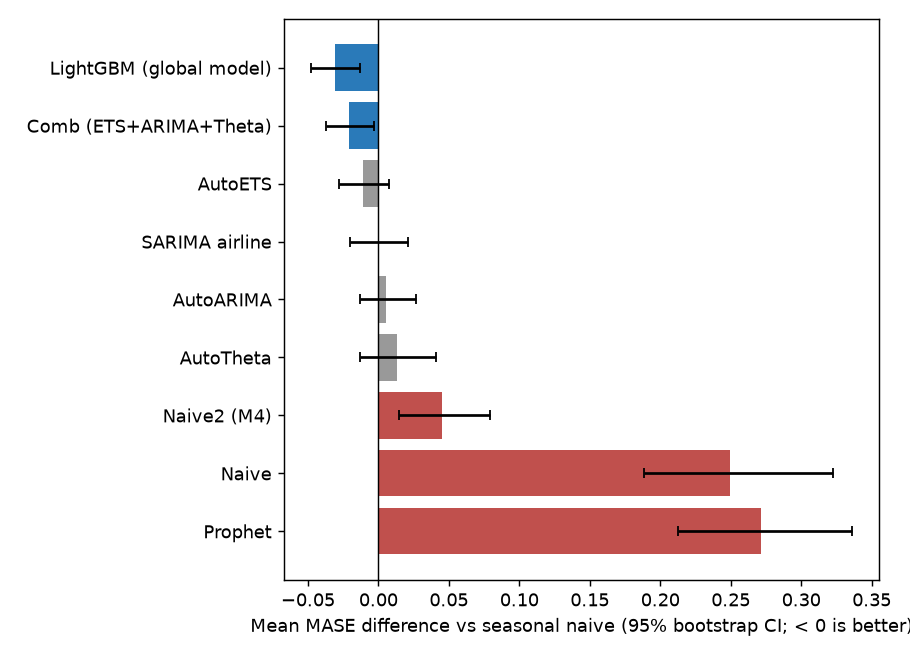
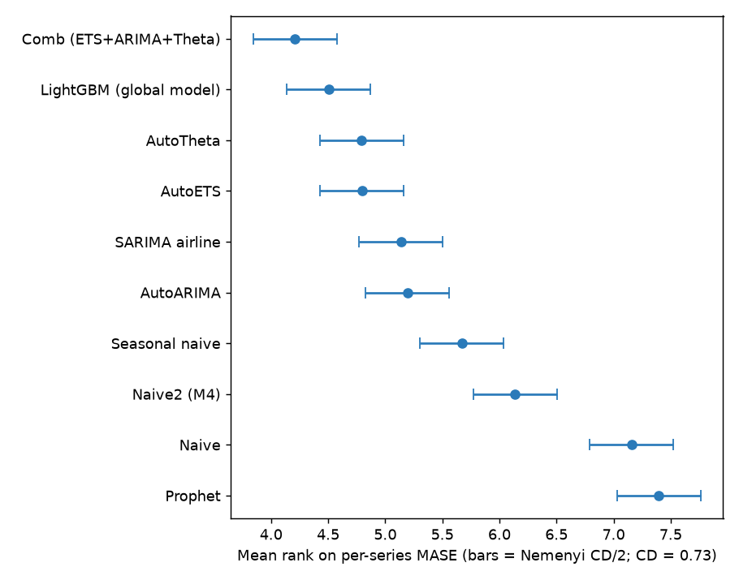
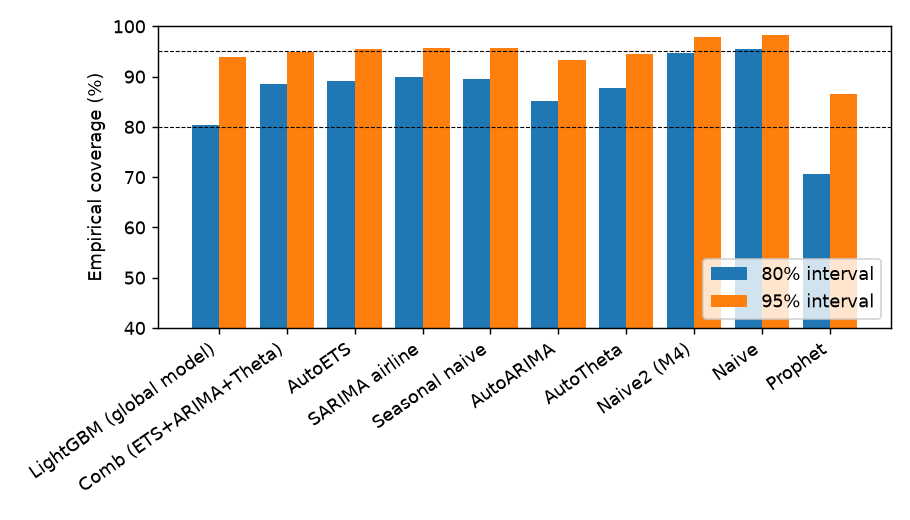
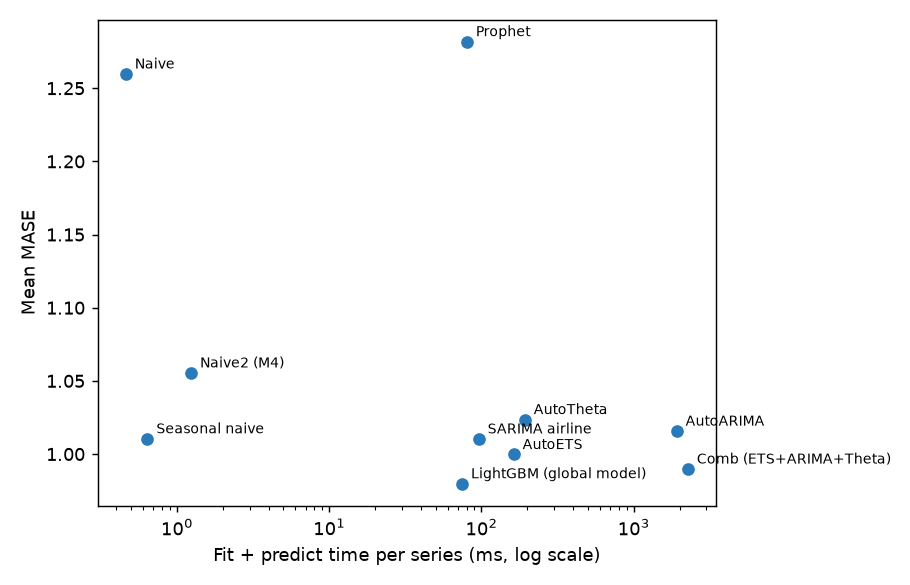
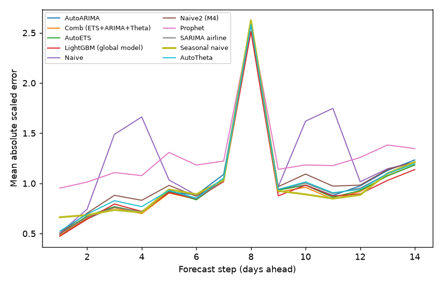

# Benchmark report: electricity-daily

342 series, horizon 14, 3 rolling-origin windows (1026 series-windows per model), seed 42. Baseline: seasonal naive. Lower is better for every error metric.

## Leaderboard

| model                   |   mase |   rel_mase |   owa |   smape |     rmse |   coverage_80 |   msis_80 |   coverage_95 |   msis_95 |   ms_per_series |        n |
|:------------------------|-------:|-----------:|------:|--------:|---------:|--------------:|----------:|--------------:|----------:|----------------:|---------:|
| LightGBM (global model) |  0.980 |      0.970 | 0.923 |   8.048 | 1327.564 |         0.805 |     5.681 |         0.940 |    10.867 |          74.487 | 1026.000 |
| Comb (ETS+ARIMA+Theta)  |  0.990 |      0.980 | 0.934 |   8.164 | 1273.207 |         0.885 |     6.102 |         0.949 |    10.926 |        2267.105 | 1026.000 |
| AutoETS                 |  1.000 |      0.989 | 0.946 |   8.289 | 1287.762 |         0.892 |     6.196 |         0.955 |    10.985 |         162.623 | 1026.000 |
| SARIMA airline          |  1.010 |      1.000 | 0.966 |   8.552 | 1284.509 |         0.900 |     6.447 |         0.958 |    11.263 |          95.797 | 1026.000 |
| Seasonal naive          |  1.010 |      1.000 | 0.950 |   8.280 | 1424.707 |         0.895 |     6.482 |         0.956 |    11.147 |           0.639 | 1026.000 |
| AutoARIMA               |  1.016 |      1.005 | 0.955 |   8.321 | 1349.321 |         0.852 |     5.990 |         0.934 |    11.151 |        1912.116 | 1026.000 |
| AutoTheta               |  1.024 |      1.013 | 0.968 |   8.481 | 1277.982 |         0.877 |     6.455 |         0.944 |    11.459 |         192.366 | 1026.000 |
| Naive2 (M4)             |  1.055 |      1.045 | 1.000 |   8.776 | 1312.173 |         0.947 |     8.290 |         0.979 |    13.115 |           1.237 | 1026.000 |
| Naive                   |  1.260 |      1.247 | 1.198 |  10.559 | 1435.218 |         0.955 |     9.861 |         0.983 |    15.336 |           0.461 | 1026.000 |
| Prophet                 |  1.282 |      1.269 | 1.274 |  11.704 | 1444.302 |         0.707 |     6.604 |         0.865 |    12.245 |          80.183 | 1026.000 |

`owa` = M4 Overall Weighted Average vs Naive2; `msis_95` = M4 mean scaled interval score.

## Significance vs seasonal naive

| model                   |   mase_diff |   mase_diff_ci_low |   mase_diff_ci_high |   win_rate_pct |   wilcoxon_p |   wilcoxon_p_holm |   dm_better_pct |   dm_worse_pct |   dm_series |   mean_rank |
|:------------------------|------------:|-------------------:|--------------------:|---------------:|-------------:|------------------:|----------------:|---------------:|------------:|------------:|
| AutoARIMA               |    0.00526  |            -0.0134 |             0.0264  |           57.6 |     0.265    |          0.385    |            9.65 |          12.6  |         342 |        5.19 |
| Comb (ETS+ARIMA+Theta)  |   -0.0207   |            -0.0371 |            -0.00307 |           62   |     8.84e-05 |          0.00053  |           11.4  |           6.73 |         342 |        4.21 |
| AutoETS                 |   -0.0107   |            -0.0281 |             0.00763 |           58.5 |     0.01     |          0.0501   |           12    |           6.73 |         342 |        4.8  |
| LightGBM (global model) |   -0.0307   |            -0.0476 |            -0.013   |           64   |     1.5e-07  |          1.05e-06 |           11.1  |           6.43 |         342 |        4.51 |
| Naive                   |    0.249    |             0.189  |             0.323   |           36   |     1.42e-13 |          1.14e-12 |            5.26 |          28.7  |         342 |        7.16 |
| Naive2 (M4)             |    0.045    |             0.0143 |             0.079   |           44.7 |     0.0298   |          0.119    |            9.06 |          14.3  |         342 |        6.14 |
| Prophet                 |    0.271    |             0.213  |             0.336   |           30.4 |     2.36e-17 |          2.12e-16 |            4.39 |          34.2  |         342 |        7.4  |
| SARIMA airline          |   -9.62e-05 |            -0.0199 |             0.0213  |           55   |     0.193    |          0.385    |            9.65 |           9.36 |         342 |        5.14 |
| AutoTheta               |    0.0131   |            -0.0128 |             0.0411  |           59.1 |     0.0367   |          0.119    |           12.3  |           8.48 |         342 |        4.79 |

Friedman test across all models: p = 4.2e-80. Nemenyi critical difference at 5%: 0.732 mean ranks.

`mase_diff` = mean per-series MASE difference (model - baseline) with a 95% series bootstrap CI; `win_rate_pct` = share of series where the model's MASE is lower; `dm_better_pct` / `dm_worse_pct` = share of series where a Diebold-Mariano test (absolute scaled error, HAC variance, HLN correction) finds the model significantly better / worse at 5%.

