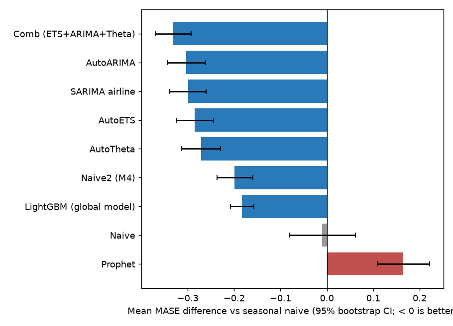
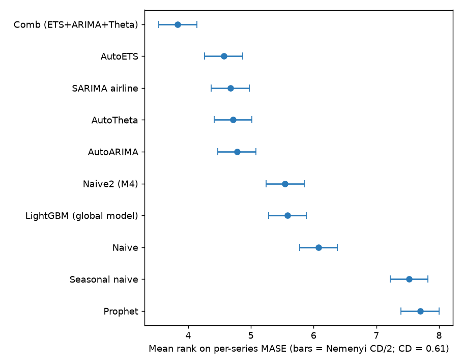
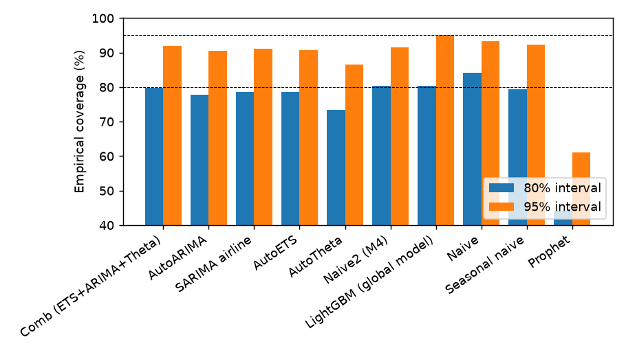
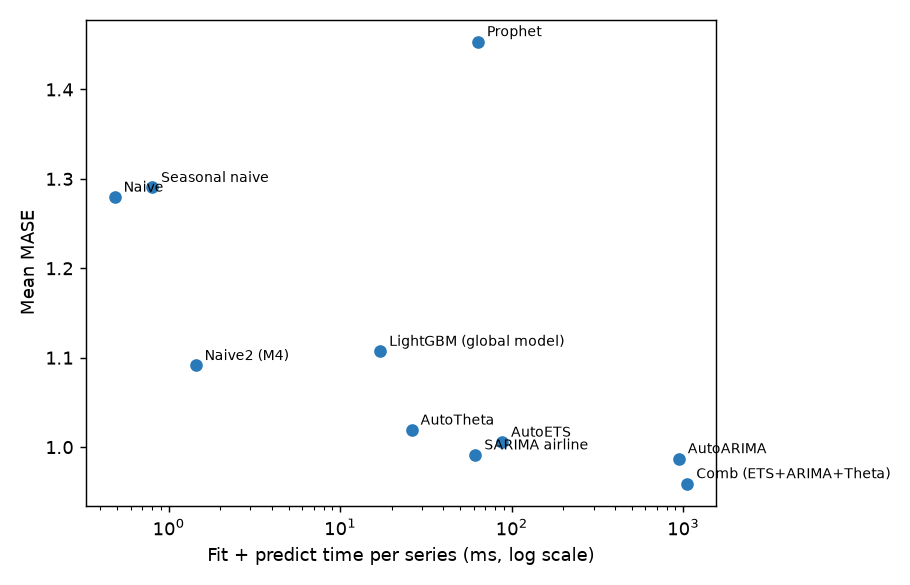
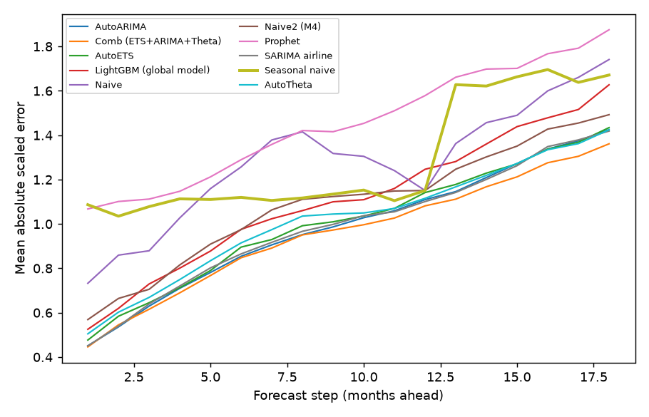

# Benchmark report: m4-monthly

500 series, horizon 18, 3 rolling-origin windows (1500 series-windows per model), seed 7. Baseline: seasonal naive. Lower is better for every error metric.

## Leaderboard

| model                   |   mase |   rel_mase |   owa |   smape |    rmse |   coverage_80 |   msis_80 |   coverage_95 |   msis_95 |   ms_per_series |        n |
|:------------------------|-------:|-----------:|------:|--------:|--------:|--------------:|----------:|--------------:|----------:|----------------:|---------:|
| Comb (ETS+ARIMA+Theta)  |  0.959 |      0.743 | 0.904 |  10.619 | 607.015 |         0.797 |     5.040 |         0.920 |     9.096 |        1056.262 | 1500.000 |
| AutoARIMA               |  0.987 |      0.765 | 0.935 |  11.028 | 631.616 |         0.777 |     5.276 |         0.906 |     9.804 |         942.370 | 1500.000 |
| SARIMA airline          |  0.991 |      0.768 | 0.961 |  11.574 | 643.588 |         0.786 |     5.308 |         0.912 |     9.685 |          61.330 | 1500.000 |
| AutoETS                 |  1.006 |      0.779 | 0.950 |  11.182 | 646.453 |         0.785 |     5.411 |         0.908 |     9.865 |          87.825 | 1500.000 |
| AutoTheta               |  1.019 |      0.790 | 0.952 |  11.074 | 627.027 |         0.733 |     5.533 |         0.866 |    10.677 |          26.067 | 1500.000 |
| Naive2 (M4)             |  1.091 |      0.846 | 1.000 |  11.424 | 655.403 |         0.804 |     6.504 |         0.915 |    11.397 |           1.437 | 1500.000 |
| LightGBM (global model) |  1.107 |      0.858 | 0.999 |  11.242 | 652.600 |         0.803 |     5.943 |         0.952 |    10.865 |          17.105 | 1500.000 |
| Naive                   |  1.280 |      0.992 | 1.128 |  12.384 | 727.462 |         0.842 |     7.740 |         0.933 |    13.104 |           0.485 | 1500.000 |
| Seasonal naive          |  1.290 |      1.000 | 1.187 |  13.603 | 788.985 |         0.795 |     6.703 |         0.922 |    11.453 |           0.801 | 1500.000 |
| Prophet                 |  1.454 |      1.126 | 1.383 |  16.387 | 849.697 |         0.441 |     9.145 |         0.612 |    22.331 |          63.557 | 1500.000 |

`owa` = M4 Overall Weighted Average vs Naive2; `msis_95` = M4 mean scaled interval score.

## Significance vs seasonal naive

| model                   |   mase_diff |   mase_diff_ci_low |   mase_diff_ci_high |   win_rate_pct |   wilcoxon_p |   wilcoxon_p_holm |   dm_better_pct |   dm_worse_pct |   dm_series |   mean_rank |
|:------------------------|------------:|-------------------:|--------------------:|---------------:|-------------:|------------------:|----------------:|---------------:|------------:|------------:|
| AutoARIMA               |     -0.303  |            -0.344  |             -0.261  |           77.8 |     3.55e-43 |          2.13e-42 |            41.6 |            3.4 |         500 |        4.78 |
| Comb (ETS+ARIMA+Theta)  |     -0.331  |            -0.37   |             -0.293  |           82.2 |     6.71e-56 |          6.04e-55 |            45.6 |            2.4 |         500 |        3.83 |
| AutoETS                 |     -0.285  |            -0.324  |             -0.245  |           78.4 |     1.06e-46 |          8.44e-46 |            44.2 |            2.8 |         500 |        4.57 |
| LightGBM (global model) |     -0.183  |            -0.208  |             -0.157  |           79.8 |     2.36e-45 |          1.65e-44 |            44   |            4.2 |         500 |        5.58 |
| Naive                   |     -0.0108 |            -0.0805 |              0.0618 |           66.2 |     2.47e-09 |          4.94e-09 |            35.6 |           13   |         500 |        6.08 |
| Naive2 (M4)             |     -0.199  |            -0.237  |             -0.16   |           73.2 |     3.96e-31 |          1.19e-30 |            42.4 |            5.4 |         500 |        5.55 |
| Prophet                 |      0.163  |             0.11   |              0.221  |           39.8 |     4.25e-08 |          4.25e-08 |            17.4 |           27.8 |         500 |        7.7  |
| SARIMA airline          |     -0.299  |            -0.34   |             -0.26   |           77.2 |     5.49e-43 |          2.74e-42 |            41.8 |            4   |         500 |        4.67 |
| AutoTheta               |     -0.271  |            -0.313  |             -0.23   |           77.8 |     6.31e-40 |          2.52e-39 |            43.8 |            4.4 |         500 |        4.72 |

Friedman test across all models: p = 2e-167. Nemenyi critical difference at 5%: 0.606 mean ranks.

`mase_diff` = mean per-series MASE difference (model - baseline) with a 95% series bootstrap CI; `win_rate_pct` = share of series where the model's MASE is lower; `dm_better_pct` / `dm_worse_pct` = share of series where a Diebold-Mariano test (absolute scaled error, HAC variance, HLN correction) finds the model significantly better / worse at 5%.

