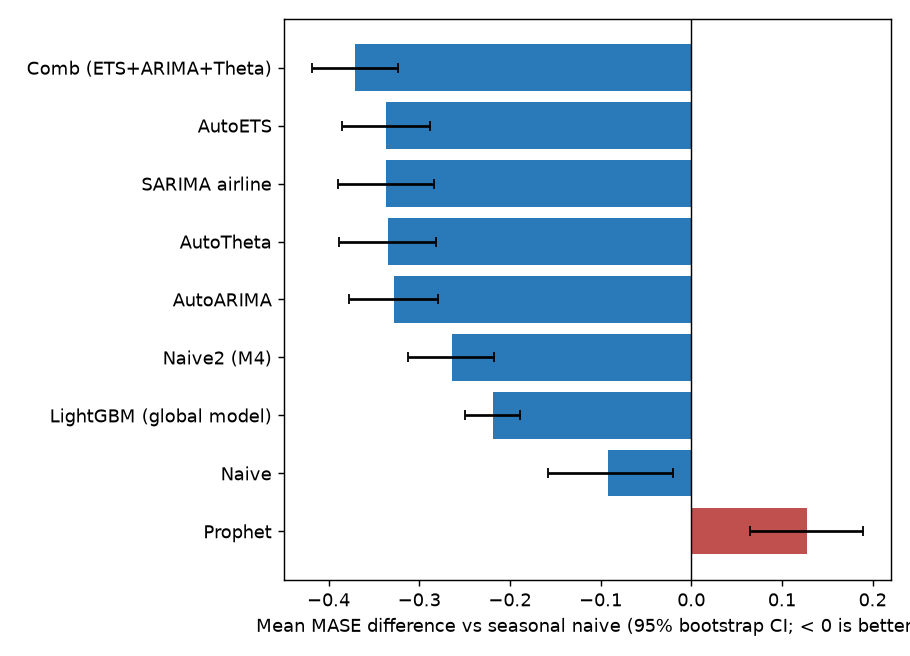
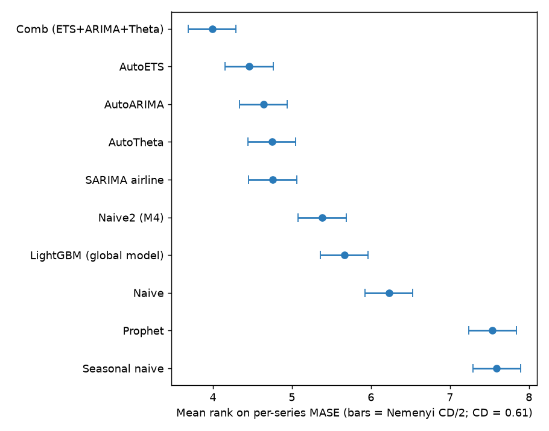
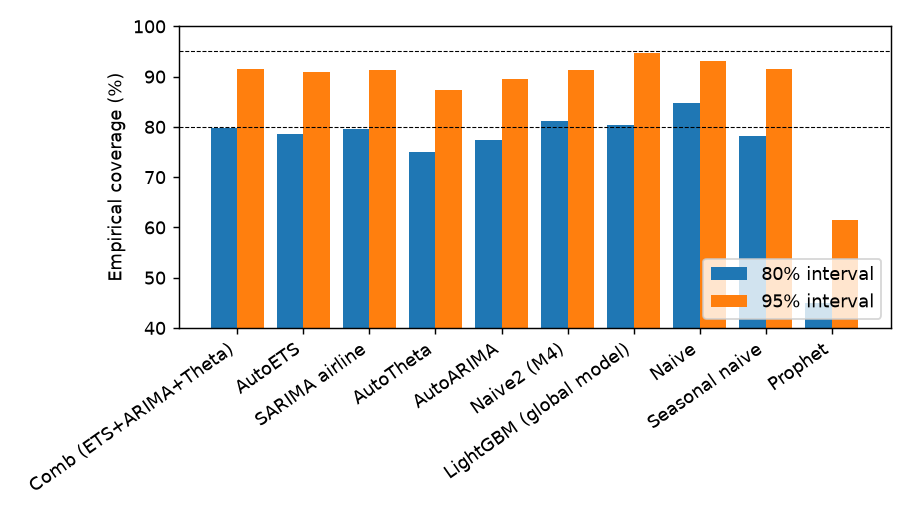
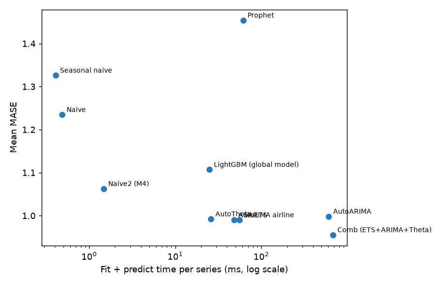
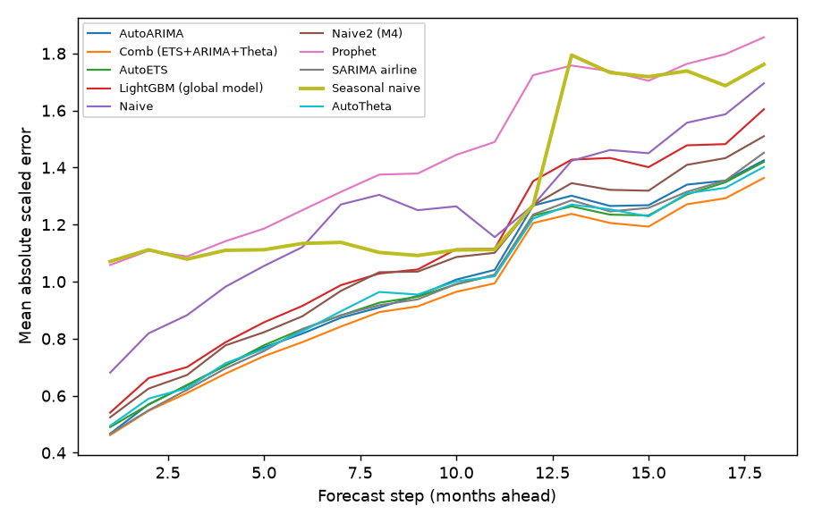

# Benchmark report: m4-monthly

500 series, horizon 18, 3 rolling-origin windows (1363 series-windows per model), seed 42. Baseline: seasonal naive. Lower is better for every error metric.

## Leaderboard

| model                                 |   mase |   rel_mase |   owa |   smape |    rmse |   coverage_80 |   msis_80 |   coverage_95 |   msis_95 |   ms_per_series |        n |
|:--------------------------------------|-------:|-----------:|------:|--------:|--------:|--------------:|----------:|--------------:|----------:|----------------:|---------:|
| Comb (ETS+ARIMA+Theta)                |  0.955 |      0.720 | 0.915 |   9.486 | 602.466 |         0.797 |     5.114 |         0.916 |     9.093 |         682.566 | 1500.000 |
| AutoETS                               |  0.990 |      0.746 | 0.942 |   9.696 | 633.876 |         0.786 |     5.243 |         0.909 |     9.358 |          48.164 | 1500.000 |
| SARIMA airline                        |  0.990 |      0.747 | 0.972 |  10.312 | 651.728 |         0.796 |     5.456 |         0.913 |    10.126 |          55.679 | 1500.000 |
| AutoTheta                             |  0.992 |      0.748 | 0.953 |   9.893 | 611.049 |         0.750 |     5.590 |         0.872 |    10.872 |          26.080 | 1500.000 |
| AutoARIMA                             |  0.998 |      0.753 | 0.961 |  10.007 | 627.774 |         0.774 |     5.588 |         0.896 |    10.813 |         608.323 | 1500.000 |
| Naive2 (M4)                           |  1.063 |      0.801 | 1.000 |  10.183 | 632.729 |         0.813 |     6.560 |         0.914 |    11.669 |           1.481 | 1500.000 |
| LightGBM (global model)               |  1.107 |      0.835 | 1.018 |  10.131 | 638.587 |         0.804 |     5.946 |         0.947 |    10.967 |          25.027 | 1500.000 |
| LightGBM, pooled intervals (ablation) |  1.107 |      0.835 | 1.018 |  10.131 | 638.587 |         0.808 |     9.513 |         0.949 |    22.395 |          24.994 | 1500.000 |
| Naive                                 |  1.235 |      0.931 | 1.139 |  11.358 | 703.280 |         0.847 |     7.781 |         0.932 |    13.320 |           0.487 | 1500.000 |
| Seasonal naive                        |  1.326 |      1.000 | 1.220 |  12.135 | 777.087 |         0.782 |     7.053 |         0.915 |    12.441 |           0.407 | 1500.000 |
| Prophet                               |  1.454 |      1.097 | 1.457 |  15.740 | 802.903 |         0.450 |     9.232 |         0.614 |    23.177 |          61.607 | 1500.000 |

`owa` = M4 Overall Weighted Average vs Naive2; `msis_95` = M4 mean scaled interval score.

## Significance vs seasonal naive

| model                   |   mase_diff |   mase_diff_ci_low |   mase_diff_ci_high |   win_rate_pct |   wilcoxon_p |   wilcoxon_p_holm |   dm_better_pct |   dm_worse_pct |   dm_series |   mean_rank |
|:------------------------|------------:|-------------------:|--------------------:|---------------:|-------------:|------------------:|----------------:|---------------:|------------:|------------:|
| AutoARIMA               |     -0.328  |            -0.377  |             -0.279  |           79   |     1.1e-40  |          6.58e-40 |            43   |            4.6 |         500 |        4.64 |
| Comb (ETS+ARIMA+Theta)  |     -0.371  |            -0.418  |             -0.324  |           81   |     3.75e-52 |          3.37e-51 |            48.8 |            3.4 |         500 |        3.99 |
| AutoETS                 |     -0.336  |            -0.385  |             -0.288  |           81   |     8.45e-48 |          6.76e-47 |            48.8 |            3   |         500 |        4.46 |
| LightGBM (global model) |     -0.219  |            -0.249  |             -0.189  |           81.6 |     2.57e-47 |          1.8e-46  |            46   |            3.6 |         500 |        5.66 |
| Naive                   |     -0.0914 |            -0.158  |             -0.0202 |           64.8 |     3.74e-09 |          7.47e-09 |            40   |           16.8 |         500 |        6.23 |
| Naive2 (M4)             |     -0.264  |            -0.312  |             -0.218  |           74.2 |     2.01e-33 |          6.03e-33 |            47.2 |            6.4 |         500 |        5.38 |
| Prophet                 |      0.128  |             0.0652 |              0.189  |           46   |     0.000174 |          0.000174 |            17   |           31   |         500 |        7.54 |
| SARIMA airline          |     -0.336  |            -0.39   |             -0.284  |           75   |     1.63e-39 |          8.14e-39 |            43   |            5.6 |         500 |        4.76 |
| AutoTheta               |     -0.334  |            -0.389  |             -0.281  |           76.4 |     1.73e-39 |          8.14e-39 |            45.2 |            7.2 |         500 |        4.75 |

Friedman test across all models: p = 1.3e-162. Nemenyi critical difference at 5%: 0.606 mean ranks.

`mase_diff` = mean per-series MASE difference (model - baseline) with a 95% series bootstrap CI; `win_rate_pct` = share of series where the model's MASE is lower; `dm_better_pct` / `dm_worse_pct` = share of series where a Diebold-Mariano test (absolute scaled error, HAC variance, HLN correction) finds the model significantly better / worse at 5%.

